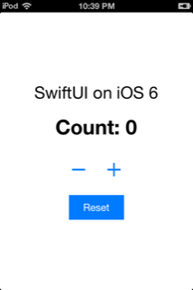
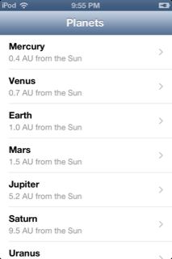
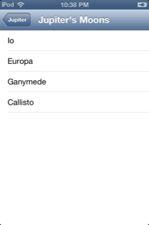
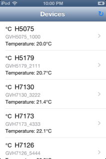

# SwiftUI on iOS 6

A port of [SwiftUI-iOS9](https://github.com/colemancda/SwiftUI-iOS9) to iOS 6:
a SwiftUI-compatible UI library in Embedded Swift, running on a jailbroken
iPod touch (4th gen, armv7, iOS 6.1.6).

<p>




</p>

The module is named `SwiftUI`, so app code keeps `import SwiftUI`:

```swift
import SwiftUI

@main
struct PlanetsApp: App {
    var body: some Scene {
        WindowGroup {
            NavigationStack {
                PlanetList()
            }
        }
    }
}

struct PlanetList: View {
    var body: some View {
        List(planets) { planet in
            NavigationLink(destination: PlanetDetail(planet: planet)) {
                Text(planet.name)
            }
        }
        .navigationTitle("Planets")
    }
}
```

## Examples

```bash
make                          # build Examples/Counter
make EXAMPLE=Planets install  # copy to the iPod
make EXAMPLE=Planets run      # launch it (the iPod must be unlocked)
```

- **Counter:** `@State`, buttons and stacks.
- **Planets:** `NavigationStack` and `List`, three screens deep (planets, then a
  planet's facts, then its moons).
- **Interop:** UIKit and Foundation from Swift through
  [ObjCInterop](../ObjC/README.md): device details, screen brightness, keeping
  the screen awake and opening a URL, with no Objective-C file. `UIKit.swift`
  declares the API as typed wrappers with ObjCInterop's macros.
- **Devices:** `NavigationView`, `List`, `@EnvironmentObject`, and an async
  `task` that updates the list every second.

`make -C .. screenshot` saves the iPod's screen to `../build/screenshot.png`.

The SDK, SSH config and app launcher come from the parent directory (see
[../README.md](../README.md)).

## What's supported

The same as SwiftUI-iOS9 (`Text`, `Button`, stacks, `Spacer`, `ForEach`,
`List`, `NavigationView`, `NavigationLink`, `@State`, `ObservableObject`,
`@EnvironmentObject`, `task`, `async`/`await` and more), plus `NavigationStack`
and `Toggle`. `NavigationStack` renders like `NavigationView` and has no `path`
binding or `navigationDestination`. `Toggle` is a `UISwitch`.

## Apps in other folders

An app outside `Examples/` (like [../WiFiScanner](../WiFiScanner/README.md))
builds with this Makefile by setting `APP`, `APP_DIR` and `BUILD`. `APP_DIR`
holds the app's Swift sources and `Info.plist`, and optionally:

- C or Objective-C sources, built for iOS like the backend.
- An `include/` folder with a Clang module, which Swift imports.
- An `Entitlements.plist` that `ldid` signs the app with.

## How the UI is wrapped

```
App code (Embedded Swift)
  └─ SwiftUI module (Embedded Swift)         Sources/SwiftUI
       └─ UIKit backend (Embedded Swift)     Sources/SwiftUI/Backend.swift
            └─ ObjCInterop                    ../ObjC: Objective-C messages and classes
                 └─ ObjCRuntime.c             objc_msgSend, built for iOS
```

The library has no Objective-C. The backend is Swift: it creates and lays out
UIKit views with [ObjCInterop](../ObjC/README.md)'s messages, and defines the
Objective-C classes UIKit needs with it:

- **SUIHostView**, a `UIView` subclass whose `layoutSubviews` runs the layout.
- **SUIActionTarget**, for target-action and touch highlighting.
- **SUINavigationDelegate** and **SUIScrollDelegate**, the navigation and
  scroll-view delegates.
- **SUIAppDelegate**, the app delegate.

The `sui_*` functions the views render through keep their names and plain C
types (`SwiftUIBackend.h` holds the types and the callback signatures), so the
rest of the module didn't change. The backend never uses dynamic casts (`as?`,
`is`): one cast in an earlier version failed on the 4S in some builds and not
others, so stacks and lists are kept in typed tables instead.

A render of the 178-view Wi-Fi Scanner list takes about 0.3 s on the iPod,
roughly 1.3 times the Objective-C backend's time. Most of it is creating
views, which takes several bridged messages per view.

- A `NavigationStack` or `NavigationView` is one `UINavigationController`,
  kept across renders. Each screen in it is a `UIViewController`. A `NavigationLink` pushes one, and the system back
  button pops it.
- A `List` is a `UIScrollView` of rows. A `NavigationLink` row highlights when
  touched and shows a chevron.
- Each render installs a screen's content in a new host view inside that
  screen's view controller.
- Renders wait while a list is being dragged or is still decelerating, and
  run once it stops. A render replaces the list's scroll view, which would end
  the scroll gesture and make scrolling stutter.
- Renders don't push or pop while a navigation transition is animating. A
  change requested during one is applied when it ends, and a pop is reported
  to Swift when it starts. Otherwise a render landing during a back animation
  pushed the screen again, which corrupts iOS 6's navigation bar.

## What changed from SwiftUI-iOS9

The Swift code is the same apart from `NavigationStack` and the `Image` glyphs.
The changes are in the backend and the build:

- **Layout with frames, not Auto Layout:** iOS 6 has no `UIStackView` or
  layout anchors. A first port used the original Auto Layout API, but every
  render rebuilds the views on screen. On the iPod's A4, adding, removing and
  solving about a thousand constraints took 1.5–2.5 seconds per render. That
  was slow enough for iOS's watchdog to kill the Wi-Fi scanner. iOS 6 Auto
  Layout also threw when a pushed screen still had constraints left over from
  replaced content.
  - Each view now reports its natural size for a proposed size.
  - `SUIStackView` places its children along an axis and gives leftover space
    to flexible children (`Spacer`, `List`, `Color`). It narrows a child that
    doesn't fit, so its text wraps.
  - Padding, background, list rows and screen hosts lay out their content in
    `layoutSubviews`.

  A render takes about 0.2 seconds for a 17-row list.
- **iOS 7–8 APIs:** fonts are regular or bold (no `UIFontWeight`). Buttons
  are custom buttons tinted blue (no `UIButtonTypeSystem` or `tintColor`).
  Layout guides aren't needed, because iOS 6 places views below the bars.
- **`memset_s`:** the concurrency runtime calls it, but iOS 6 has no `memset_s`
  (it arrived in iOS 7), so dyld refused to launch the app.
  `Sources/CSwiftUIBackend/Compat.c` defines it.
- **r9:** Embedded Swift targets bare-metal armv7, where callees must preserve
  `r9`. On iOS, any function may overwrite it. Our Swift and C code avoids
  `r9` (`-ffixed-r9`), but the prebuilt `libswift_Concurrency.a` keeps values
  in it. iOS 6's `malloc` returns with `r9 = 0xffffffff`, which crashed the
  first `Task`. `tools/r9wrap.py` runs at link time:
  - It finds every function that bare-metal code (Swift objects, executor,
    runtime archives) calls in iOS code: libSystem and the `sui_*` backend.
  - It writes a trampoline for each one that saves and restores `r9`.
  - It renames the references in copies of those objects with `llvm-objcopy`.
  - It reads the stack-argument counts for the `sui_*` functions from the header.
- **Symbols:** `Image(systemName:)` maps to characters iOS 6's fonts have
  (`thermometer` is ℃, for example). Characters newer than Unicode 6.1 have no
  glyph on iOS 6.

## Limits

The same as SwiftUI-iOS9, and also:

- iOS 6 appearance: glossy navigation bars and back buttons. There's no
  swipe-to-go-back, which arrived in iOS 7.
- Only regular and bold system fonts.
